# MobiControl

MobiControl is an experimental Android interface for the Tandem Mobi insulin pump. It is derived
from [ControlX2](https://github.com/jwoglom/controlX2) and uses
[PumpX2](https://github.com/jwoglom/pumpX2) for pump communication.
Maintained by [ian-dee](https://github.com/ian-dee). Not an official Tandem product.

## Purpose

The project explores a customizable, glanceable pump interface designed around how people use
their phones: checking glucose without opening a full app, viewing pump activity at a glance,
and moving through clear, understandable workflows. Foldable phones are a particular focus,
with separate layouts for the main display and the smaller cover screen.

MobiControl builds on the work of ControlX2 and PumpX2 rather than starting a new protocol stack.
Its development priorities are straightforward interactions, visible pump state, and maintainable
implementation. The pump remains the source of truth for its settings and delivery state;
emulator previews are kept separate from real pump communication. The longer-term intent is to
make the project understandable and approachable for collaborators, subject to upstream licensing.

## Features in the current development build

These are implemented capabilities, not a claim that every device, firmware version or failure
case has been validated. See [known limitations](docs/KNOWN_LIMITATIONS.md) for outstanding issues.

### Dashboard and history

- Glucose reading and trend, insulin on board (IOB), pump battery, cartridge insulin level,
  connection status, and Control-IQ mode.
- Glucose, basal-delivery and bolus history on a shared timeline, with distinct manual and
  automatic bolus markers and pump-time-change indicators.
- Configurable graph control limits and glucose-dot colors, separate from CGM alert thresholds.
- Chronological pump history with day grouping and incremental loading of older events.

### Pump and CGM workflows

- Bolus preparation with food/correction calculations, manual glucose input and dose override,
  device authentication, delivery progress, and cancellation.
- Personal-profile viewing and editing, Control-IQ settings and sleep schedules, temporary
  rates, and pump safety-limit settings.
- Cartridge change, tubing fill and cannula fill workflows, with site-change information
  and reminders.
- Dexcom G7 session viewing, adoption of an existing pump session, sensor replacement,
  calibration, and CGM alert settings.
- Pump pairing/unpairing and pump-time synchronization workflows.

### Foldable layouts and personalization

- A compact cover-screen interface focused on glucose, IOB, recent delivery history and bolus
  access, alongside the full-screen interface.
- Android widgets with glucose/trend, IOB and mode information; larger layouts include history.
- Selectable visual skins, including skin-aware widget presentation.
- Independently configurable system-notification families for bolus activity/reminders,
  CGM alerts, site changes, battery and cartridge warnings. System-notification preferences
  are separate from pump commands and in-app workflow presentation.

### Integrations

- Glucose export to **GlucoseDataHandler** and xDrip-compatible receivers. GlucoseDataHandler
  can provide downstream watch-face/complication integration without enabling watch pump control.
- **Carb Capture**: capture a meal photo, add an optional note, and hand it off to the installed
  ChatGPT app. The response stays in ChatGPT; this is not an embedded ChatGPT conversation or
  an automatic input to the bolus calculator. Any carbohydrate estimate requires user review.

Direct watch pump-control integration remains disabled. Retained watch code is not a supported
watch-control feature.

## Screenshots

These are native UI captures using **synthetic demonstration data**, not patient records or
screenshots from a paired phone. They show the three selectable skins in light mode. Tap an
image to view it at full size; expand a skin below for its screens, bolus workflow and widgets.

| POR | Instrument | Field Kit |
| --- | --- | --- |
| <a href="docs/screenshots/por/dashboard.png">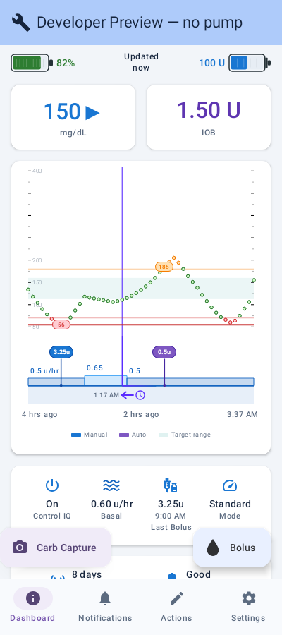</a> | <a href="docs/screenshots/instrument/dashboard.png">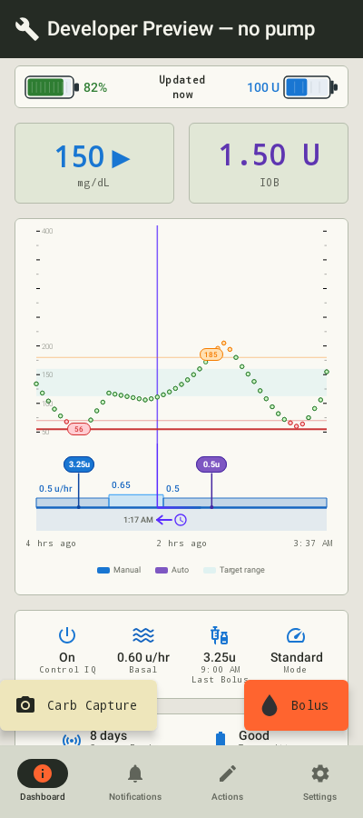</a> | <a href="docs/screenshots/field-kit/dashboard.png">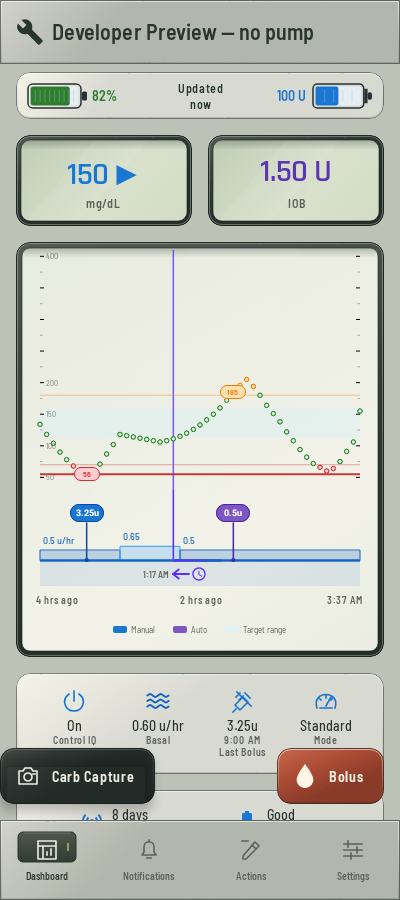</a> |

POR — screens, bolus workflow, cover screen and widgets

### Main screens

Dashboard is shown above. These are the other three bottom-navigation destinations.

| Notifications | Actions | Settings |
| --- | --- | --- |
| <a href="docs/screenshots/por/notifications.png">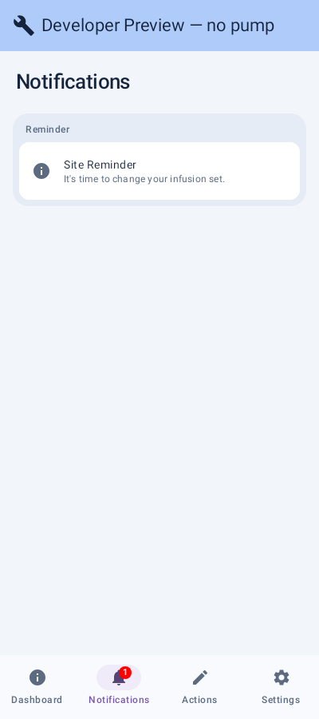</a> | <a href="docs/screenshots/por/actions.png">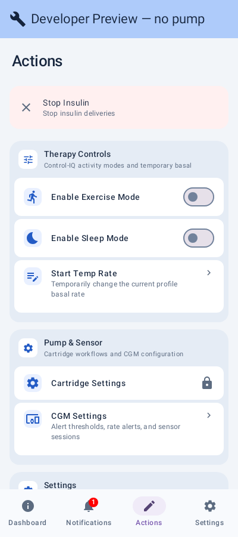</a> | <a href="docs/screenshots/por/settings.png">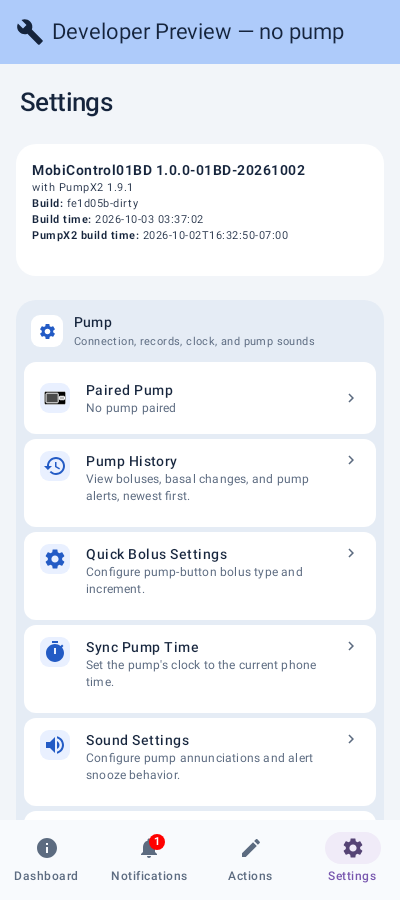</a> |

### Carb Capture and cover screen

| Carb Capture | Compact cover-screen dashboard |
| --- | --- |
| <a href="docs/screenshots/por/carb-capture.png">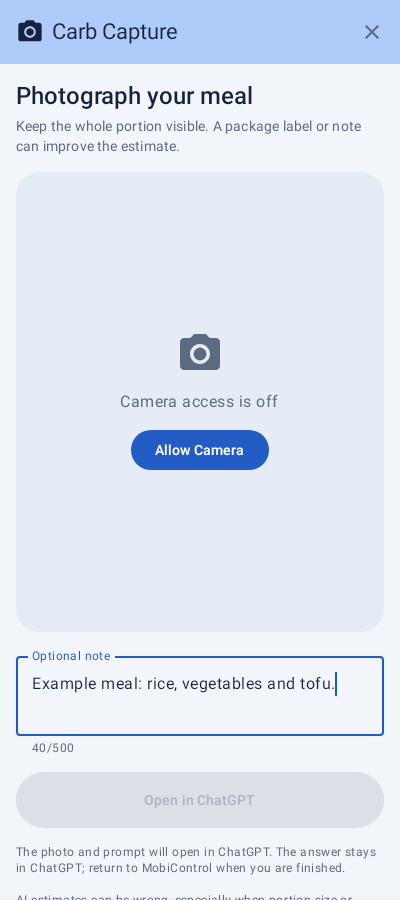</a> | <a href="docs/screenshots/por/cover-screen.png">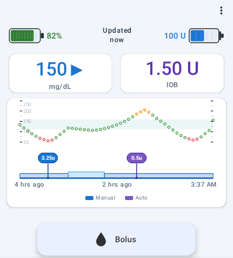</a> |

### Bolus workflow

| 1 · Correction choice | 2 · Calculation | 3 · Review |
| --- | --- | --- |
| <a href="docs/screenshots/por/bolus-01-correction.png">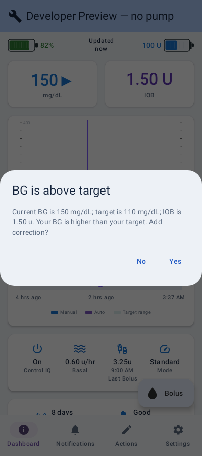</a> | <a href="docs/screenshots/por/bolus-02-calculation.png">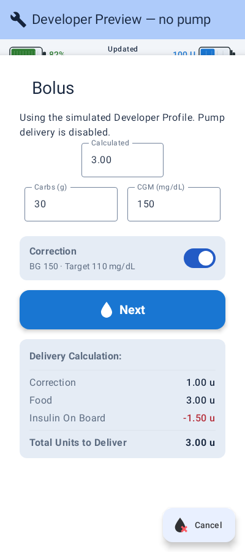</a> | <a href="docs/screenshots/por/bolus-03-review.png">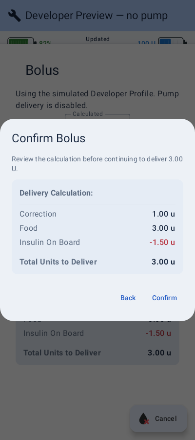</a> |

| 4 · Hold to deliver | 5 · Simulated progress | 6 · Stop confirmation |
| --- | --- | --- |
| <a href="docs/screenshots/por/bolus-04-hold.png">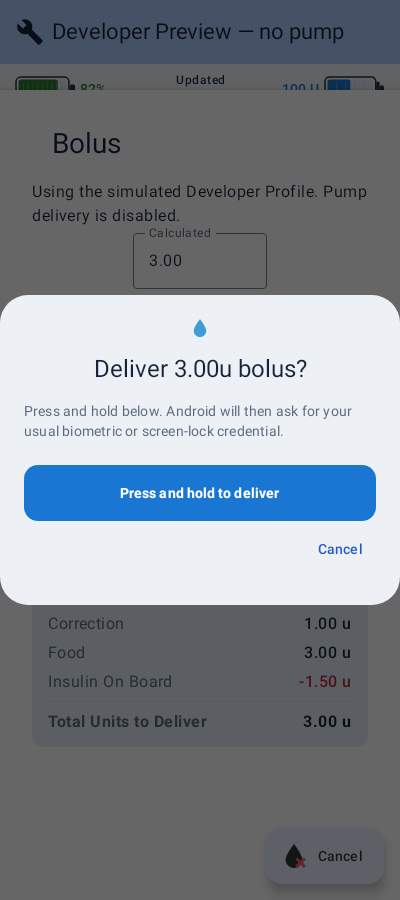</a> | <a href="docs/screenshots/por/bolus-05-progress.png">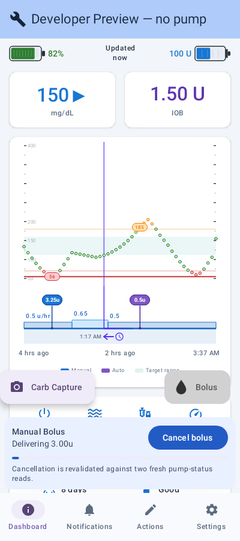</a> | <a href="docs/screenshots/por/bolus-06-stop-confirmation.png">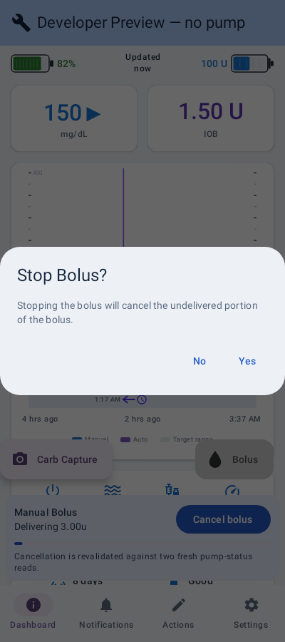</a> |

### Widgets

| Compact | History |
| --- | --- |
| <a href="docs/screenshots/por/widget-compact.png">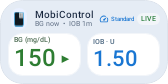</a> | <a href="docs/screenshots/por/widget-history.png">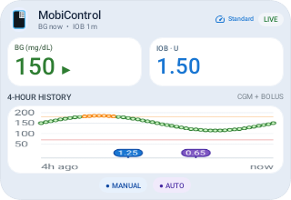</a> |

| Cover compact | Cover wide |
| --- | --- |
| <a href="docs/screenshots/por/widget-cover-compact.png">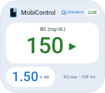</a> | <a href="docs/screenshots/por/widget-cover-wide.png">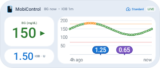</a> |

Instrument — screens, bolus workflow, cover screen and widgets

### Main screens

Dashboard is shown above. These are the other three bottom-navigation destinations.

| Notifications | Actions | Settings |
| --- | --- | --- |
| <a href="docs/screenshots/instrument/notifications.png">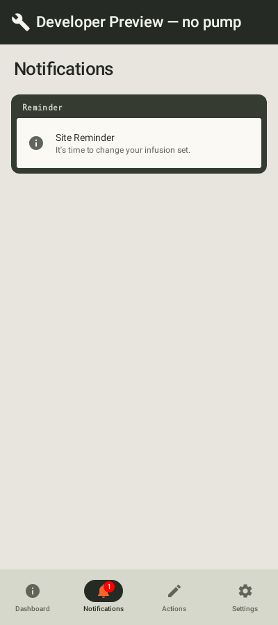</a> | <a href="docs/screenshots/instrument/actions.png">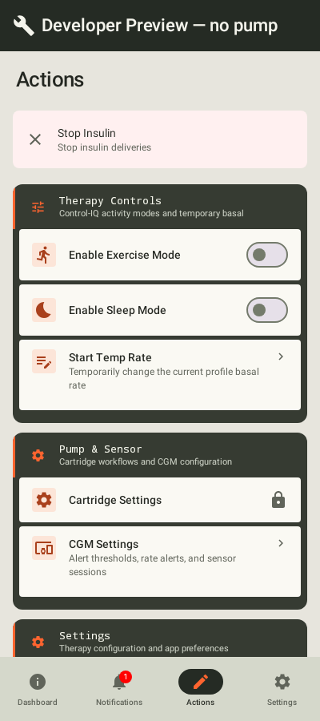</a> | <a href="docs/screenshots/instrument/settings.png">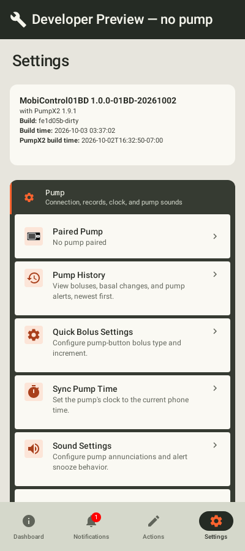</a> |

### Carb Capture and cover screen

| Carb Capture | Compact cover-screen dashboard |
| --- | --- |
| <a href="docs/screenshots/instrument/carb-capture.png">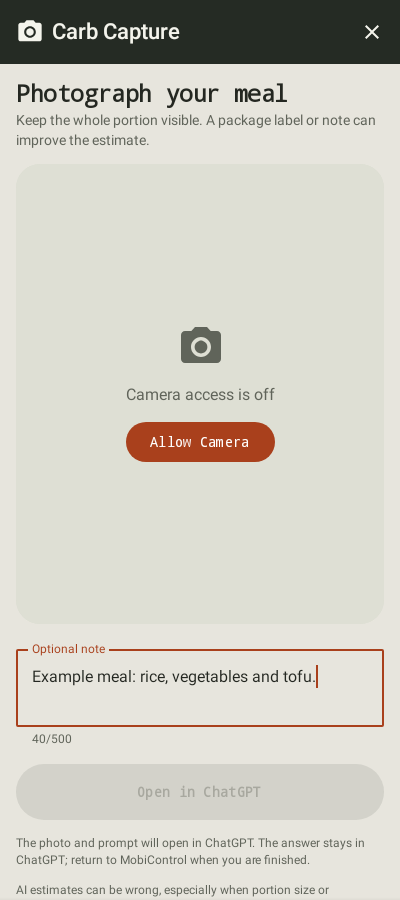</a> | <a href="docs/screenshots/instrument/cover-screen.png">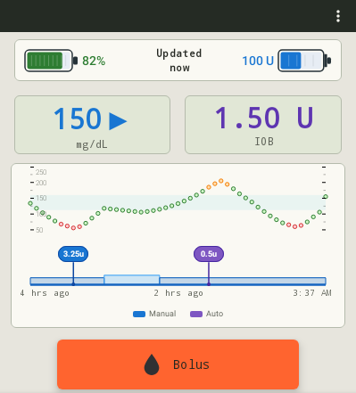</a> |

### Bolus workflow

| 1 · Correction choice | 2 · Calculation | 3 · Review |
| --- | --- | --- |
| <a href="docs/screenshots/instrument/bolus-01-correction.png">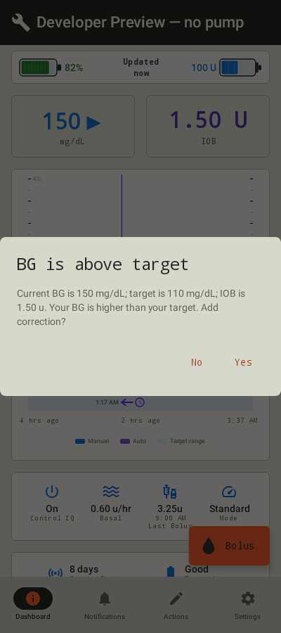</a> | <a href="docs/screenshots/instrument/bolus-02-calculation.png">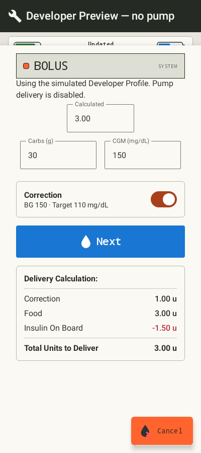</a> | <a href="docs/screenshots/instrument/bolus-03-review.png">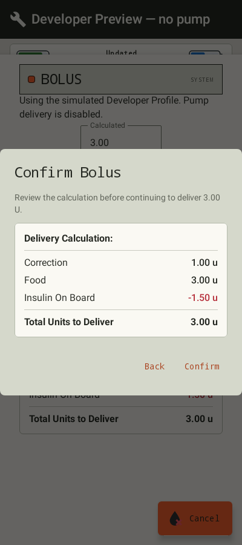</a> |

| 4 · Hold to deliver | 5 · Simulated progress | 6 · Stop confirmation |
| --- | --- | --- |
| <a href="docs/screenshots/instrument/bolus-04-hold.png">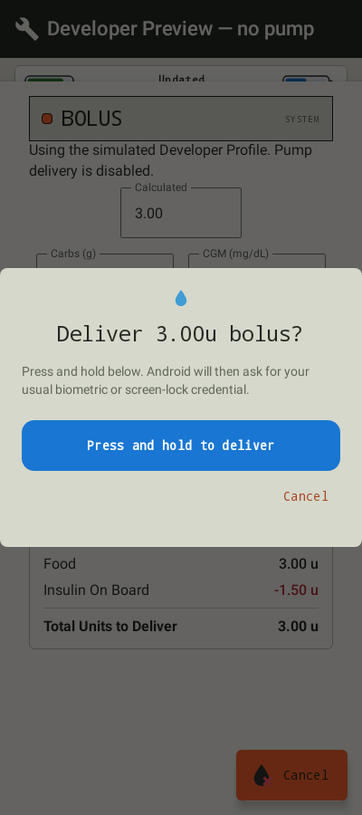</a> | <a href="docs/screenshots/instrument/bolus-05-progress.png">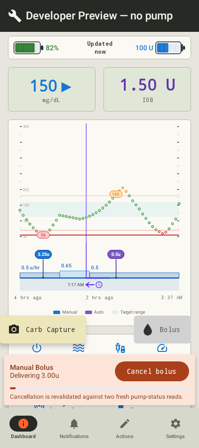</a> | <a href="docs/screenshots/instrument/bolus-06-stop-confirmation.png">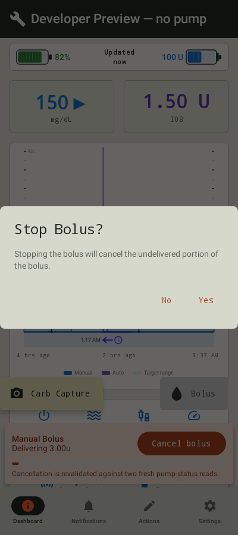</a> |

### Widgets

| Compact | History |
| --- | --- |
| <a href="docs/screenshots/instrument/widget-compact.png">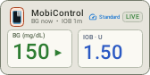</a> | <a href="docs/screenshots/instrument/widget-history.png">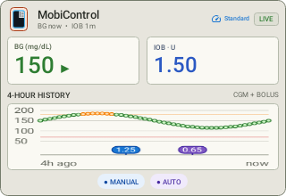</a> |

| Cover compact | Cover wide |
| --- | --- |
| <a href="docs/screenshots/instrument/widget-cover-compact.png">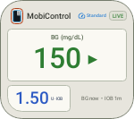</a> | <a href="docs/screenshots/instrument/widget-cover-wide.png">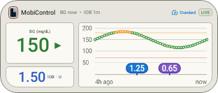</a> |

Field Kit — screens, bolus workflow, cover screen and widgets

### Main screens

Dashboard is shown above. These are the other three bottom-navigation destinations.

| Notifications | Actions | Settings |
| --- | --- | --- |
| <a href="docs/screenshots/field-kit/notifications.png">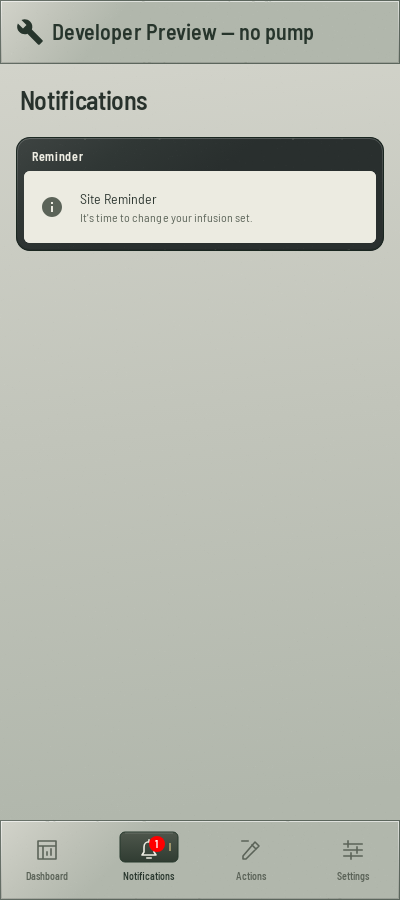</a> | <a href="docs/screenshots/field-kit/actions.png">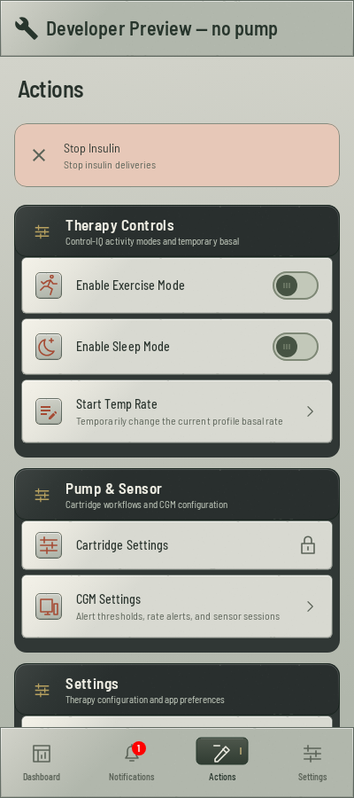</a> | <a href="docs/screenshots/field-kit/settings.png">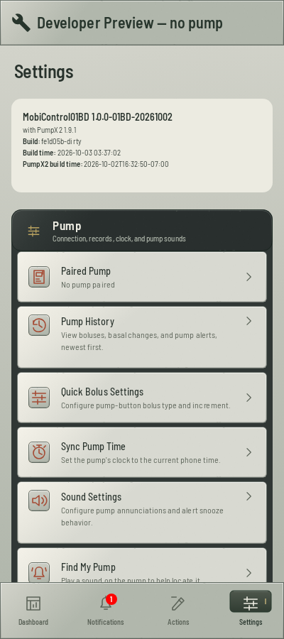</a> |

### Carb Capture and cover screen

| Carb Capture | Compact cover-screen dashboard |
| --- | --- |
| <a href="docs/screenshots/field-kit/carb-capture.png">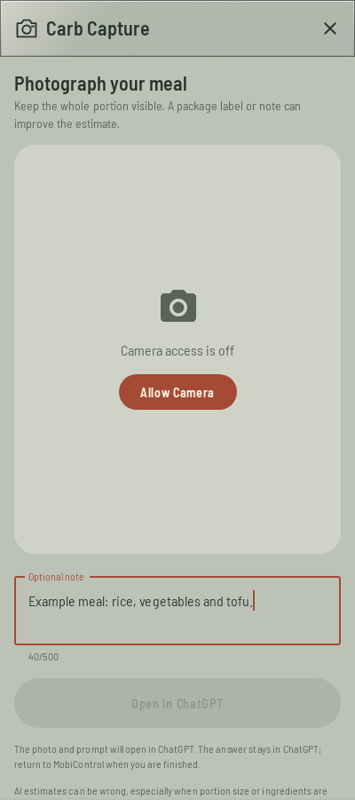</a> | <a href="docs/screenshots/field-kit/cover-screen.png">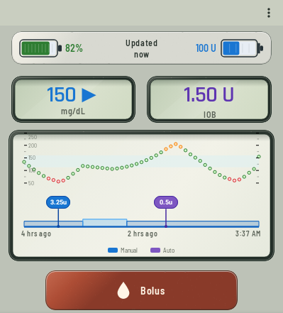</a> |

### Bolus workflow

| 1 · Correction choice | 2 · Calculation | 3 · Review |
| --- | --- | --- |
| <a href="docs/screenshots/field-kit/bolus-01-correction.png">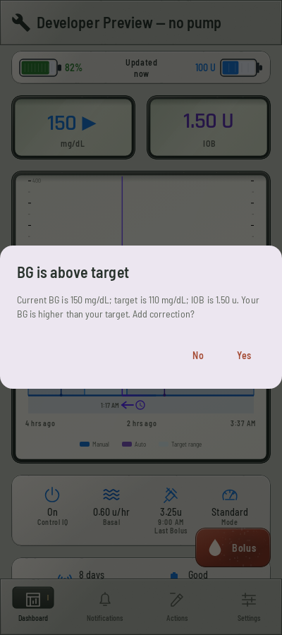</a> | <a href="docs/screenshots/field-kit/bolus-02-calculation.png">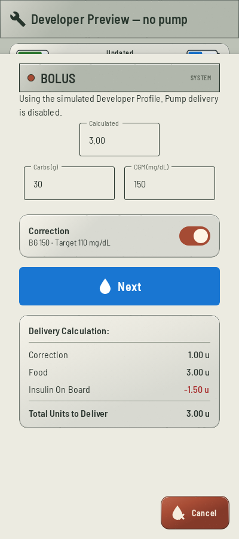</a> | <a href="docs/screenshots/field-kit/bolus-03-review.png">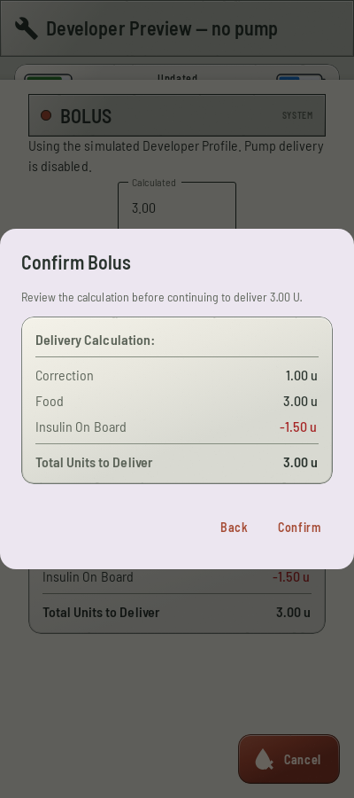</a> |

| 4 · Hold to deliver | 5 · Simulated progress | 6 · Stop confirmation |
| --- | --- | --- |
| <a href="docs/screenshots/field-kit/bolus-04-hold.png">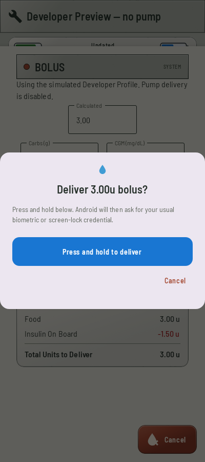</a> | <a href="docs/screenshots/field-kit/bolus-05-progress.png">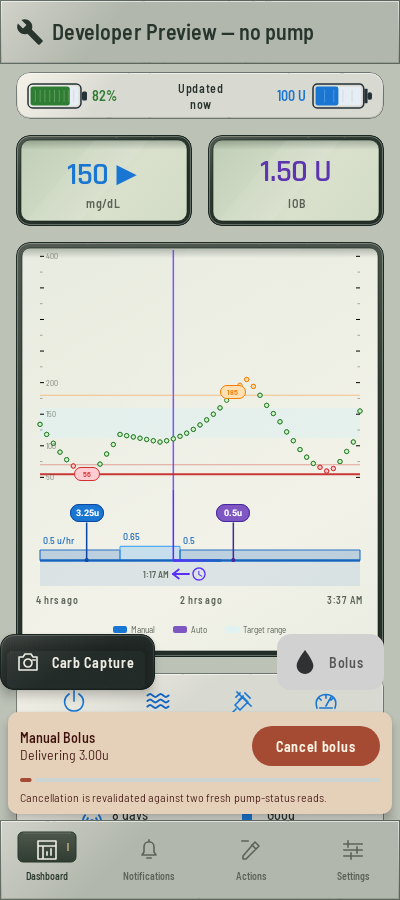</a> | <a href="docs/screenshots/field-kit/bolus-06-stop-confirmation.png">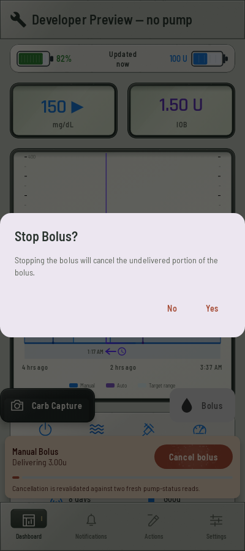</a> |

### Widgets

| Compact | History |
| --- | --- |
| <a href="docs/screenshots/field-kit/widget-compact.png">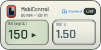</a> | <a href="docs/screenshots/field-kit/widget-history.png">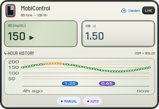</a> |

| Cover compact | Cover wide |
| --- | --- |
| <a href="docs/screenshots/field-kit/widget-cover-compact.png">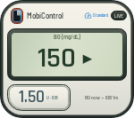</a> | <a href="docs/screenshots/field-kit/widget-cover-wide.png">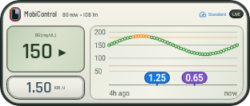</a> |

The bolus sequence uses developer preview and a simulated successful authentication callback;
it does **not** show an Android biometric/passcode prompt or demonstrate real delivery. Carb Capture
is shown with camera access off and no photo, so submission is unavailable. Widgets are rendered
without launcher chrome. Android system bars are omitted from app captures.

See [capture provenance and regeneration instructions](docs/screenshots/README.md). These images
illustrate the interface, not medical advice, compatibility certification or bench validation.

## Development hardware and testing

Development has taken place on macOS with Android emulators and Samsung Galaxy Z Flip-series
hardware. Local test records identify **Samsung model SM-F776U1** as a development/test device,
including main-display, cover-screen and widget use. Emulator layouts cover both full-screen
and compact interfaces. Pump-facing development has included isolated Tandem Mobi bench testing;
earlier exploratory work also used a t:slim X2.

This describes the project's development environment, not a supported-device list. A reviewed
phone/Android/pump-firmware compatibility matrix has not yet been published. Cover-screen and
widget availability also depend on the phone's software and launcher. Model information is
included for context; personal device identifiers and raw pump records are not publication inputs.

Automated unit tests, emulator UI checks and physical bench tests provide different kinds of
evidence. Implemented does not mean bench-verified in every circumstance, and success on one
configuration does not establish compatibility with another.

## Experimental status

This is development and bench-test software, not a validated replacement for the official app.
Automated tests do not establish safety or clinical suitability. Do not use developer-preview
values as treatment settings. Do not connect an unvalidated build to a pump providing therapy.

## Publication status

This source preparation is local pending licensing clarification and the final privacy review.
ControlX2's repository-wide license is unresolved; see [the maintainer inquiry](https://github.com/jwoglom/controlX2/issues/165).
No license grant for ControlX2-derived code is implied by this README. PumpX2 is MIT licensed.
The exact dependency commit must be published before the default bootstrap can fetch it.

## Development

See [build instructions](docs/BUILDING.md), [architecture](docs/ARCHITECTURE.md),
[known limitations](docs/KNOWN_LIMITATIONS.md), and [contribution requirements](CONTRIBUTING.md).

Developer preview is for emulator UI testing and uses synthetic fixtures. It is not a pump
simulator and does not prove pump behavior. No real patient profiles, device captures or private
phone screenshots are publication inputs. Report bugs using synthetic reproduction steps,
not raw pump logs.

## Credits

MobiControl builds on James Woglom's ControlX2 and PumpX2. Original upstream history and notices
are retained. See [third-party notices](THIRD_PARTY_NOTICES.md).
